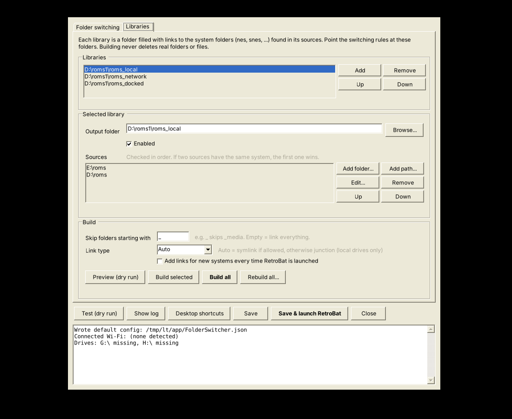

# RetroBat Folder Switcher

A tiny Windows launcher that points RetroBat at the right ROM library, then starts RetroBat.

| Priority | Condition | Folder used |
|---|---|---|
| 1 | Connected Wi-Fi name contains `sireteanu` | `roms-local` |
| 2 | Drives `G:\` **and** `H:\` are both present | `roms-docked` |
| 3 | Anything else | `roms-default` (your original `roms`) |

## How it works

RetroBat always reads `RetroBat\roms`. Instead of editing `es_systems.cfg` (RetroBat overwrites it on updates), the switcher turns `roms` into a **directory junction** and re-points it on every launch. Junctions are transparent to RetroBat and the emulators, and creating them does **not** require admin rights.

**First run:** if `roms` is still a real folder, it is renamed to `roms-default` and `roms` becomes the junction. Nothing is ever deleted or merged. If `roms-default` already exists, the switcher stops and tells you in the log.

If the chosen folder doesn't exist (e.g. no `roms-docked` yet), it falls back to `roms-default`.

If RetroBat/EmulationStation is already running, the link is left alone and RetroBat is just launched.

## Install

1. Download `RetroBatFolderSwitcher.zip` from [Releases](../../releases).
2. Put `RetroBatFolderSwitcher.exe` in your RetroBat folder (next to `retrobat.exe`).
3. Create the folders you want next to it: `roms-local`, `roms-docked` (they can themselves be junctions to G:/H: or a NAS share).
4. Run `RetroBatFolderSwitcher.exe --settings` (or hold Shift while opening it) to configure, and click **Desktop shortcuts** if you want them.
5. Launch RetroBat through `RetroBatFolderSwitcher.exe` (Steam shortcut, desktop shortcut, Playnite, etc.).

Requires .NET Framework 4.8, which ships with Windows 10/11.

## Settings window

Open it with `RetroBatFolderSwitcher.exe --settings`, or **hold Shift** while launching the exe.


- Turn each rule on/off, set the Wi-Fi text, drives and folder for each rule.
- **Use current** fills in the Wi-Fi you're connected to; **Check** shows which drives are present.
- **Right now** shows which rule would win on this machine at this moment.
- **Open** opens (or offers to create) each folder.
- **Test (dry run)** shows exactly what would happen without changing anything.
- **Desktop shortcuts** creates `RetroBat (Folder Switcher)` and `RetroBat Folder Switcher Settings` on your desktop.
- **Save & launch RetroBat** saves, switches the folder and starts RetroBat.

## Libraries (building the roms folders)

The **Libraries** tab builds the folders the rules point at, the same way `create_symlinks_win_multiple.bat` did. Each library is an output folder filled with one link per system folder (`nes`, `snes`, ...) found in its sources.



- **Sources are checked in order.** If two sources have the same system, the first one wins.
- Folders starting with the **skip prefix** (default `_`, e.g. `_media`) aren't linked.
- Anything already in the output folder is left alone, and sources that don't exist (an unplugged drive) are skipped with a warning.
- **Build all** adds links for any new systems. **Rebuild all** removes the existing links and recreates them, which you need after changing the source order. Only links are ever removed, never real folders or files.
- **Add links for new systems every time RetroBat is launched** runs *Build all* before switching.
- To use a library, pick its output folder (e.g. `D:\roms1\roms_local`) as a rule's folder on the first tab. Full paths work.

**Link types**
- **Auto** (default): a symlink if Windows allows it, otherwise a junction.
- **Symlink**: needs **Developer Mode** (Settings → System → For developers) or running as administrator. This is required for network sources such as a mapped `Z:` drive.
- **Junction**: no admin needed, but only for local drives.

Turning on Developer Mode is the easiest option. It lets symlinks work without "Run as administrator", which matters because an elevated app often can't see your mapped network drives.

Your three groups from the `.bat` are the starting setup.

## Configuration file

Settings are stored in `FolderSwitcher.json` next to the exe (created on first run):

```json
{
  "RetroBatPath": "",
  "RetroBatExe": "retrobat.exe",
  "LaunchArguments": "",
  "LinkName": "roms",
  "WifiRuleEnabled": true,
  "WifiSsidContains": "sireteanu",
  "WifiFolder": "roms-local",
  "DockedRuleEnabled": true,
  "DockedDrives": [ "G:\\", "H:\\" ],
  "DockedFolder": "roms-docked",
  "DefaultFolder": "roms-default",
  "Libraries": [
    { "Enabled": true, "Output": "D:\\roms1\\roms_local", "Sources": [ "E:\\roms", "D:\\roms" ] }
  ],
  "SkipPrefix": "_",
  "LinkType": "Auto",
  "BuildLibrariesOnLaunch": false
}
```

- `RetroBatPath`: leave empty if the exe sits in the RetroBat folder; otherwise e.g. `"D:\\RetroBat"`.
- Set `WifiRuleEnabled` / `DockedRuleEnabled` to `false` to disable a rule.

## Command line

- `--settings`: open the settings window.
- `--build-libraries`: build all libraries and exit (add `--dry-run` to preview).
- `--rebuild-libraries`: remove and recreate all library links, then exit.
- `--dry-run`: log the decision only; change nothing and don't launch.
- `--no-launch`: switch the folder but don't start RetroBat.

Everything is logged to `FolderSwitcher.log` next to the exe.

## Notes

- **Wi-Fi detection** uses the Windows WLAN API (falls back to `netsh wlan show interfaces`). It reads the physical Wi-Fi adapter, so a VPN like WireGuard doesn't affect it.
- **Windows 11 24H2+** only gives apps the Wi-Fi name when *Location services* are on and *Let desktop apps access your location* is allowed (Settings → Privacy & security → Location). If the log shows `Connected Wi-Fi: (none detected)` while you're on Wi-Fi, check that setting.

## Build

```
dotnet build src/FolderSwitcher.csproj -c Release
```

Every push to `main` builds the exe on GitHub Actions. Bump `<Version>` in `src/FolderSwitcher.csproj` and push to publish a new release zip.
