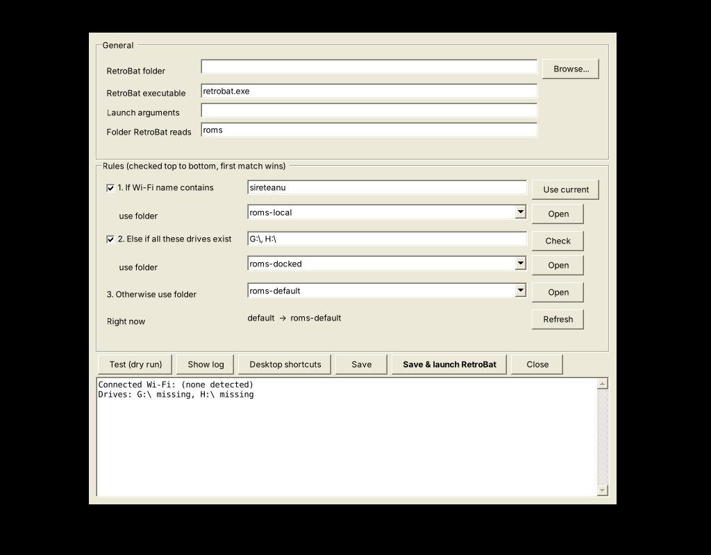

# RetroBat ROM Switcher

A tiny Windows launcher that points RetroBat at the right ROM library, then starts RetroBat.

| Priority | Condition | Folder used |
|---|---|---|
| 1 | Connected Wi-Fi name contains `sireteanu` | `roms-local` |
| 2 | Drives `G:\` **and** `H:\` are both present | `roms-docked` |
| 3 | Anything else | `roms-default` (your original `roms`) |

## How it works

RetroBat always reads `RetroBat\roms`. Instead of editing `es_systems.cfg` (RetroBat overwrites it on updates), the switcher turns `roms` into a **directory junction** and re-points it on every launch. Junctions are transparent to RetroBat and the emulators, and creating them does **not** require admin rights.

**First run:** if `roms` is still a real folder, it is renamed to `roms-default` and `roms` becomes the junction. Nothing is ever deleted or merged. If `roms-default` already exists, the switcher stops and tells you in the log.

If the chosen folder doesn't exist (e.g. no `roms-docked` yet), it falls back to `roms-default`.

If RetroBat/EmulationStation is already running, the link is left alone and RetroBat is just launched.

## Install

1. Download `RetroBatRomSwitcher.zip` from [Releases](../../releases).
2. Put `RetroBatRomSwitcher.exe` in your RetroBat folder (next to `retrobat.exe`).
3. Create the folders you want next to it: `roms-local`, `roms-docked` (they can themselves be junctions to G:/H: or a NAS share).
4. Run `RetroBatRomSwitcher.exe --settings` (or hold Shift while opening it) to configure, and click **Desktop shortcuts** if you want them.
5. Launch RetroBat through `RetroBatRomSwitcher.exe` (Steam shortcut, desktop shortcut, Playnite, etc.).

Requires .NET Framework 4.8, which ships with Windows 10/11.

## Settings window

Open it with `RetroBatRomSwitcher.exe --settings`, or **hold Shift** while launching the exe.



- Turn each rule on/off, set the Wi-Fi text, drives and folder for each rule.
- **Use current** fills in the Wi-Fi you're connected to; **Check** shows which drives are present.
- **Right now** shows which rule would win on this machine at this moment.
- **Open** opens (or offers to create) each folder.
- **Test (dry run)** shows exactly what would happen without changing anything.
- **Desktop shortcuts** creates `RetroBat (ROM Switcher)` and `RetroBat ROM Switcher Settings` on your desktop.
- **Save & launch RetroBat** saves, switches the folder and starts RetroBat.

## Configuration file

Settings are stored in `RomSwitcher.json` next to the exe (created on first run):

```json
{
  "RetroBatPath": "",
  "RetroBatExe": "retrobat.exe",
  "LaunchArguments": "",
  "LinkName": "roms",
  "WifiRuleEnabled": true,
  "WifiSsidContains": "sireteanu",
  "WifiFolder": "roms-local",
  "DockedRuleEnabled": true,
  "DockedDrives": [ "G:\\", "H:\\" ],
  "DockedFolder": "roms-docked",
  "DefaultFolder": "roms-default"
}
```

- `RetroBatPath`: leave empty if the exe sits in the RetroBat folder; otherwise e.g. `"D:\\RetroBat"`.
- Set `WifiRuleEnabled` / `DockedRuleEnabled` to `false` to disable a rule.

## Command line

- `--settings`: open the settings window.
- `--dry-run`: log the decision only; change nothing and don't launch.
- `--no-launch`: switch the folder but don't start RetroBat.

Everything is logged to `RomSwitcher.log` next to the exe.

## Notes

- **Wi-Fi detection** uses the Windows WLAN API (falls back to `netsh wlan show interfaces`). It reads the physical Wi-Fi adapter, so a VPN like WireGuard doesn't affect it.
- **Windows 11 24H2+** only gives apps the Wi-Fi name when *Location services* are on and *Let desktop apps access your location* is allowed (Settings → Privacy & security → Location). If the log shows `Connected Wi-Fi: (none detected)` while you're on Wi-Fi, check that setting.

## Build

```
dotnet build src/RomSwitcher.csproj -c Release
```

Tag a version (`git tag v1.0.0 && git push --tags`) and GitHub Actions publishes a release zip.
