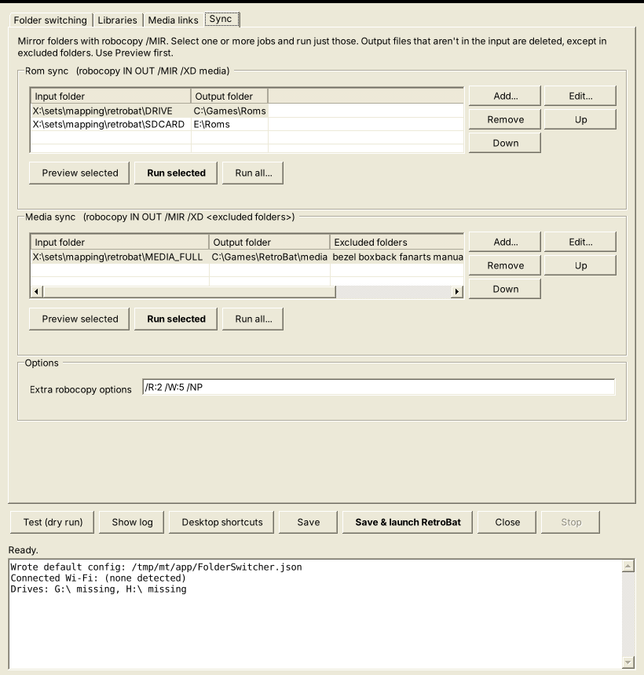

# RetroBat Folder Switcher

A small Windows tool for RetroBat that:

1. **Switches the roms folder** on launch: by Wi-Fi network, by which drives are plugged in, or a default.
2. **Builds library folders** made of links to system folders spread across several drives.
3. **Adds media links** to rom folders that were copied without their `media` folders.
4. **Runs robocopy syncs** one job at a time, with a preview and the full output in the log.

Everything is set up in one settings window. Launching RetroBat through the exe is silent.

## Install

1. Download `RetroBatFolderSwitcher.zip` from [Releases](../../releases) and put `RetroBatFolderSwitcher.exe` next to `retrobat.exe`.
2. Hold **Shift** while opening it (or run `RetroBatFolderSwitcher.exe --settings`) to open settings.
3. Click **Desktop shortcuts** if you want a "RetroBat (Folder Switcher)" launcher and a settings shortcut.
4. Launch RetroBat through `RetroBatFolderSwitcher.exe` from Steam, a desktop shortcut, Playnite and so on.

It needs .NET Framework 4.8, which ships with Windows 10 and 11.

**Tip:** turn on **Developer Mode** (Settings → System → For developers). It lets the tool create symlinks without "Run as administrator", which matters for network drives. Links between local drives work either way.

## Folder switching


| Priority | Condition | Folder used |
|---|---|---|
| 1 | Connected Wi-Fi name contains the text you set | Wi-Fi folder |
| 2 | All the listed drives are present | Docked folder |
| 3 | Anything else | Default folder (your original `roms`) |

RetroBat always reads `RetroBat\roms`. The tool turns `roms` into a **link** and points it at the chosen folder each launch, so `es_systems.cfg` (which RetroBat overwrites on updates) is never edited. A rule's folder can be a name inside the RetroBat folder or a full path, such as a library below.

- **First run:** if `roms` is a real folder, it's renamed to the default folder (`roms-default`). Nothing is ever deleted or merged.
- If a rule's folder doesn't exist, it falls back to the default. If RetroBat is already running, the link is left alone.
- **Right now** shows which rule would win at this moment, and **Test (dry run)** shows exactly what would happen.
- Wi-Fi detection reads the Wi-Fi adapter directly, so a VPN such as WireGuard doesn't affect it. On **Windows 11 24H2+**, apps only see the Wi-Fi name when Location is on (Settings → Privacy & security → Location → *Let desktop apps access your location*).

## Libraries


Each library is an output folder filled with one link per system folder (`nes`, `snes`, ...) found in its sources:

- **Sources are checked in order.** If two sources have the same system, the first one wins.
- Folders starting with the **skip prefix** (default `_`, e.g. `_media`) aren't linked.
- Anything already in the output folder is left alone, and missing sources (an unplugged drive) are skipped with a warning.
- **Build all** adds links for new systems. **Rebuild all** removes and recreates the links, which you need after changing the source order. Only links are ever removed.
- **Link type:** *Auto* makes a symlink if Windows allows it, otherwise a junction. *Symlink* needs Developer Mode or admin, and is required for network sources. *Junction* needs no admin but only works for local drives.
- **Update library and media links every time RetroBat is launched** runs *Build all* and the media links before switching.

## Media links


For rom folders copied without media (`robocopy ... /XD media`), this puts the media back with links:

```
E:\Roms\nes\media  ->  C:\Games\RetroBat\media\nes\media
```

- Every system folder in each **rom folder** gets a `media` link, when `<media folder>\<system>\media` exists.
- Systems without media are skipped, and an existing real `media` folder is never touched.
- `robocopy /MIR /XD media` never removes these links, so you can re-sync any time.
- Libraries that link to these rom folders pick up the media automatically.

## Sync (robocopy)



Two lists of mirror jobs. Select one or more jobs and run only those, so a full sync never happens unless you ask for it.

| List | Command | You set |
|---|---|---|
| Rom sync | `robocopy IN OUT /MIR /XD media` | input folder, output folder |
| Media sync | `robocopy IN OUT /MIR /XD <excluded>` | input folder, output folder, excluded folders |

- **Preview selected** runs robocopy with `/L`, which lists what would be copied and deleted without changing anything.
- **Run selected** and **Run all** ask for confirmation first and show the exact commands.
- Robocopy's full output streams into the log window and `FolderSwitcher.log`. Each job ends with its exit code and what it means.
- **Stop** cancels the running job, and any remaining jobs are skipped.
- **Extra robocopy options** (default `/R:2 /W:5 /NP`) are added to every job. Robocopy's default retry setting can wait for days on a single locked file.
- Excluded folders are separated by spaces or commas. Put quotes around names that contain spaces: `"my folder"`.
- **Safety checks:** a job won't run if the input is missing or empty (mirroring an empty folder would wipe the output), if the output is a whole drive or a system folder, or if the input and output overlap.

## Settings file

Everything is saved in `FolderSwitcher.json` next to the exe. Unknown or missing keys fall back to defaults, so older files keep working.

## Command line

| Option | Does |
|---|---|
| *(none)* | Update links if that option is on, switch the folder, launch RetroBat |
| `--settings` | Open the settings window (same as holding Shift) |
| `--dry-run` | Log what would happen, change nothing, don't launch |
| `--no-launch` | Switch the folder but don't start RetroBat |
| `--build-libraries` | Build libraries and media links, then exit (`--dry-run` to preview) |
| `--rebuild-libraries` | Remove and recreate library and media links, then exit |

Everything is logged to `FolderSwitcher.log` next to the exe. In settings, right-click the log for *Copy all*, *Clear* and *Open log file*. **Ctrl+S** saves.

## Build

```
dotnet build src/FolderSwitcher.csproj -c Release
```

Every push to `main` builds the exe on GitHub Actions. Bump `<Version>` in `src/FolderSwitcher.csproj` and push to publish a new release.
